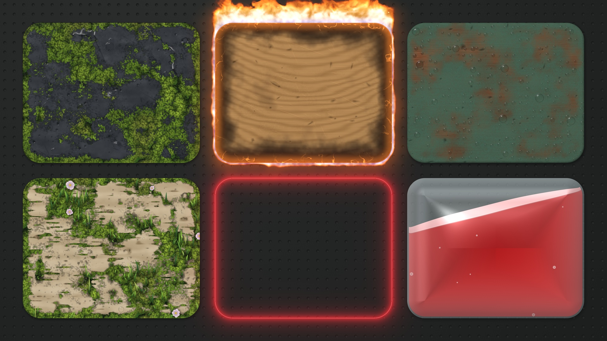

# kiss_physical

A physically lit UI kit for Flutter. Cards, buttons, sliders and panels are
solid bodies with bevels, highlights and cast shadows, drawn by fragment
shaders and lit by one light that stays put in the world while the device
turns beneath it.

**[Try the live demo](https://wamf.github.io/kiss_physical/)** — move the
pointer, or drag a finger, to carry the light. In an installed app the light
follows the tilt of the device instead.



- **One light.** A `WorldLight` at the root follows the device's tilt and,
  optionally, the sun and moon through the day. Every surface below reads it.
- **Materials.** A `PhysicalMaterial` describes a body's shape and finish:
  satin plastic, gloss pills, beads, wells, glass. Layer a texture (woods,
  marbles, stones, metals), wear, growth, and effects (rain, flame, neon,
  liquid) on top.
- **Depth layers.** A pegboard background lies beneath the content and a
  parallax layer floats above it, so tilting the device shows real depth.
- **Cheap to run.** Each body is one analytic shader pass in its own layer.
  A change of light repaints that layer and never rebuilds a widget; a
  device left still costs no frames.

Runs on iOS, Android, macOS and the web (CanvasKit or Skwasm). Until the
shaders load, and wherever they cannot, bodies paint as flat shapes in their
own colour.

## Install

```yaml
dependencies:
  kiss_physical: ^0.1.0
```

The shaders ship inside the package and are bundled with your app
automatically; there is nothing to declare in your own `pubspec.yaml`.

## Set up

Compile the shaders before the first frame and hang a light over the app:

```dart
import 'package:flutter/material.dart';
import 'package:kiss_physical/kiss_physical.dart';

Future<void> main() async {
  WidgetsFlutterBinding.ensureInitialized();
  await PhysicalShader.precache();
  runApp(const WorldLight(child: MyApp()));
}
```

`WorldLight` samples the gyroscope and accelerometer at a modest rate, only
on handheld devices, only while the app is in the foreground, and not at all
when the user asked for reduced motion. On desktop and web the light rests
above the top-left of the screen.

Without any light above them, surfaces use that same resting light
(`PhysicalLight.still`), so widget tests and previews need no set-up.

The ready-made components (`PhysicalCard`, `PhysicalPanel` and friends) need
no set-up either. Where an app uses
[`kiss_layout`](https://pub.dev/packages/kiss_layout) and
[`kiss_color`](https://pub.dev/packages/kiss_color), they take their corner
radius from the nearest `Layout` and their colour from the nearest
`SemanticColors`. Without those they use the standard layout and the
surface colour of the theme.

## Surfaces

`PhysicalSurface` is the lit body behind any content.

```dart
PhysicalSurface(
  color: const Color(0xFF3B393E),
  material: PhysicalMaterial.satin,
  borderRadius: BorderRadius.circular(20),
  child: const Padding(
    padding: EdgeInsets.all(16),
    child: Text('A moulded slab'),
  ),
)
```

Use `PhysicalSurface.stadium` as the radius for a pill or a disc, and
`PhysicalPressable` for a surface that sinks under the finger:

```dart
PhysicalPressable(
  onTap: save,
  color: accent,
  semanticLabel: 'Save',
  child: const Center(child: Text('Save')),
)
```

`PhysicalGlass` lays a clear lens over a photograph, and `PhysicalLens`
refracts whatever is beneath it at the rim.

## Materials

Start from a preset:

| Preset | Suited to |
|---|---|
| `satin` | Cards and panels |
| `matte` | Flat, flush slabs |
| `gloss` | Pills and buttons |
| `bead` | Discs, spheres, slider thumbs |
| `glass` | Glass over photographs |
| `well` | Tracks and recessed boxes |
| `socket` | Unselected chips |
| `peg` | Pegboard sockets |
| `panel`, `floatingPanel` | Panels flush with, or raised above, a background |

Then layer on what the body is made of, what has happened to it and what is
happening to it now:

```dart
final weathered = PhysicalMaterial.satin
    .withTexture(PhysicalTexture.granite.imperfect(0.7))
    .withDecals(const PhysicalDecals(moss: 0.5, dew: 0.4));

final brushed = PhysicalMaterial.satin
    .withTexture(PhysicalTexture.stainlessSteel);

final burning = PhysicalMaterial.gloss
    .withTexture(PhysicalTexture.walnut)
    .withEffect(const PhysicalEffect.flame());

final tank = PhysicalMaterial.gloss
    .withVessel(const PhysicalVessel.liquid());
```

Flames, rain and liquid follow real gravity as the device is tilted.

## Light

```dart
WorldLight(
  sky: sky, // a ValueListenable<SkyLight>, optional
  child: app,
)
```

`SkyLight.at(DateTime.now())` gives where the sun or moon stands and the
colour of its light: warm and low at dusk, cool and dim by moonlight. Leave
`sky` out for a white light straight overhead.

To place the light yourself, in a storybook or a screenshot test, use a
`PhysicalLight` in place of `WorldLight`:

```dart
PhysicalLight(
  direction: const AlwaysStoppedAnimation(Offset(-0.25, -0.45)),
  child: child,
)
```

## Depth layers

```dart
PhysicalPegboard(
  color: background,
  scrollsWithContent: true,
  depth: 28,
  child: Stack(
    children: [
      content,
      Align(
        alignment: Alignment.bottomCenter,
        child: PhysicalParallaxLayer(child: navigationMenu),
      ),
    ],
  ),
)
```

The pegboard's sockets lie `depth` pixels beneath the content and slide with
its scrolling; the parallax layer floats above it. As the device tilts the
two shift in opposite directions.

## Controls and panels

| Widget | What it is |
|---|---|
| `PhysicalPillButton` | A Material button drawn as a glossy pill |
| `physicalButtonStyle` | The same look for any `FilledButton`, `TextButton` or `ElevatedButton`, as a `ButtonStyle` or theme |
| `PhysicalIconButton` | A round bead carrying an icon |
| `PhysicalSlider` | A bead on a recessed track |
| `PhysicalProgressBar` | A glossy bar filling a recessed track |
| `PhysicalCard`, `PhysicalDisc`, `PhysicalPill` | Clipping card shapes |
| `PhysicalPanel`, `PhysicalBottomPanel` | Panels, flat or raised |
| `PhysicalDotGrid` | Hundreds of beads and sockets in one shader pass |

```dart
PhysicalSlider(
  value: volume,
  onChanged: setVolume,
  barColor: accent,
  trackColor: Colors.white24,
  thumbColor: Colors.white,
)
```

```dart
MaterialApp(
  theme: ThemeData(
    filledButtonTheme: FilledButtonThemeData(
      style: physicalButtonStyle(
        color: accent,
        foregroundColor: Colors.white,
      ),
    ),
  ),
)
```

## Storybook

[`example/`](example) is a Widgetbook,
[hosted here](https://wamf.github.io/kiss_physical/), with every component, a
gallery of the materials, a playground with a knob for each material
parameter, and controls for the light: its position, the hour of the day,
and whether it follows the device.

```bash
cd example
dart run build_runner build --delete-conflicting-outputs
flutter run
```

## Performance notes

- Give long lists of small lit shapes to one `PhysicalDotGrid` rather than
  one `PhysicalSurface` each.
- Set `isFaceCovered` on a `PhysicalSurface` whose child hides its whole
  face, such as a photograph, so only the shadow is drawn.
- Animated materials (rain, flame, liquid) repaint every frame while on
  screen; plain ones rest until the light moves.
